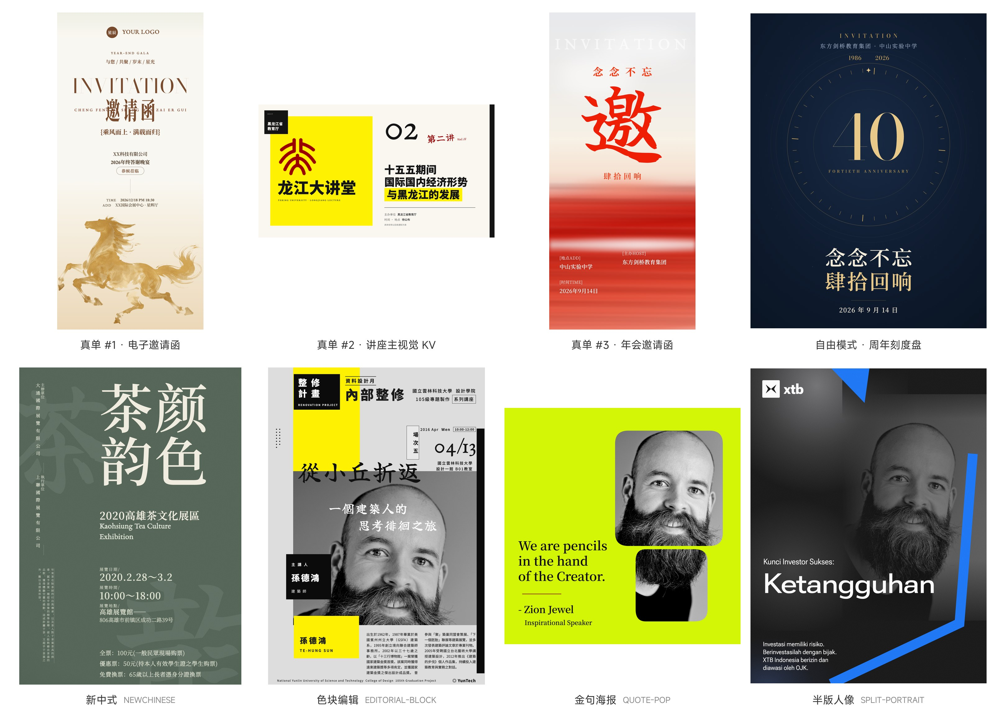

# viz-studio · 视觉工作室

<p align="center">
  一套用 <strong>HTML/CSS 写图</strong>的海报工作室（Agent Skill）：固定画布、不调 AI 生图——文字永远锐利、配色可控、改稿定点改不重做。以 Claude Code / opencode 等 Agent Skills 形式交付。
</p>

覆盖 11 类物料：小红书封面 / 公众号封面 / 讲座·年会·活动主视觉 KV / 电子邀请函 / 宣传海报 / 数据长图 / 名片 / 三折页 / 易拉宝 / 道旗 / PPT。内置 13 套由真实模板蒸馏而来的风格族，外加「自由模式」原创构图协议。

## 效果

- **13 套风格族**：从暗夜光束到新中式到鎏金奢华，均由用户提供的真实模板经「做 → 批 → 改」两三轮蒸馏收敛而成，气质可复现
- **四种输入模式**：文案直出 / 图片复刻 / 换风格改配色 / 自由模式，覆盖从「给文字」到「给图照做」到「别套模板自己想」的全谱需求
- **固定画布出图**：11 类物料各有 CSS 画布与 DPI / 出血 / 盲区纪律，印刷换算 `px = mm ÷ 25.4 × DPI`
- **单文件交付**：一个 .html 自包含样式与字体，渲染导出即成品，改稿只动对应区块
- **内置 10 款可商用字体**：思源黑/宋、MiSans、LXGW 文楷、漓雨手书、EB Garamond、Bodoni Moda、Roboto Flex、Rozha One，自包含零外链
- **真单验证**：3 张真实订单 + 1 张自由模式验证单全部一次交付通过

<p align="center">
  
</p>

## 30 秒开始

```bash
# 1. 安装（克隆到你的 skills 目录，以 Claude Code 为例）
git clone https://github.com/tongwenhui/viz-studio.git ~/.claude/skills/viz-studio

# 2. 新开会话，直接对你的 AI 助手说：
# 「帮我做一张 40 周年年会邀请函，veil-glow 光影纱幕风」
```

不装也可以先看效果：`trials/` 里是 13 个风格族的蒸馏期试做复刻图，`tests/` 里是真单验收的成品图与源 HTML。

## 四种输入模式

| 模式 | 触发 | 要点 |
|---|---|---|
| **A 文案直出** | 用户给文案 / 主题 | 五问打包追问 → 简报确认 → 按分册排版出图 |
| **B 图片复刻** | 用户给参考图 | 网格测量、取色、文案逐字、分区数字比对；只追问用途 + 尺寸 |
| **C 换风格改配色** | 在已有作品上换皮 | 只动 `:root` tokens 与字体栈，版式结构不动 |
| **D 自由模式** | 用户说「自由模式 / 自行设计 / 别套模板」 | 不读任何分册布局原型，从内容结构原创构图；必读 `references/freestyle.md` |

## 13 个风格族

| 风格族 | 气质关键词 | 典型物料 |
|---|---|---|
| **tech-beam-dark 暗夜光束** | 暗底 / 放射光效 / 居中大字 | 发布会 KV、科技海报 |
| **organic-sweep 有机曲面** | 黄绿大渐变 / 白色飘带 / 巨字 | 环保·活力主题主视觉 |
| **editorial-swath 材质编辑** | 深绿底 / 中央材质摄影卡 / 衬线 | 品牌·产品杂志风海报 |
| **newchinese 新中式** | 纸纹底 / 宋明体大字 / 直排 | 文化活动、节气海报 |
| **zen-collage 日系拼贴** | 白底黑宋阶梯标题 / 照片拼贴 / 红点睛 | 展览、生活美学封面 |
| **tech-air-longform 浅色科技长图** | 浅蓝白渐变 / 3D 飘带 / 玻璃卡 | 产品说明、数据长图 |
| **ivory-gold 象牙金** | 米白底 / 金主色 / 鎏金插画 / 衬线大写字标 | 电子邀请函、庆典 |
| **veil-glow 光影纱幕** | 柔焦光影渐变底 / 衬线书法大字 | 年会邀请函、晚宴 |
| **silk-flare 绸缎鎏金** | 暗红黑底 / 绸缎光影 / 金白衬线 | 重奢华庆典、高定 |
| **data-graphic 数据图形** | 大数字 / 模块网格 | 数据长图、报告配图 |
| **editorial-block 色块编辑** | 大色块 / 人像摄影 / 杂志层级 | 人物海报、讲座 KV |
| **quote-pop 金句海报** | 大底色 / 黑白人像 / 引言胶囊 | 金句卡、社交传播图 |
| **split-portrait 半版人像** | 暗底噪纹 / 半版人像渐隐 / 巨型标题 | 人物专访、招生·招聘 |

风格选择规则：用户带风格词或参考图先命中分册；只给文案时按内容气质推荐；「自由模式」明确点名才启用，不猜。

## 适合 / 不适合

| 适合 ✔ | 不适合 ✘ |
|---|---|
| 封面 / KV / 邀请函 / 海报 / 长图 / 名片 / 折页 / 道旗 / 易拉宝 | 照片级 AI 生成插画（人物、写实场景） |
| 文字信息为主的平面设计物料 | 可交互网页、动效视频 |
| 给参考图要求像素级复刻 | 需要反复随机抽卡的「开盲盒」式生图 |
| 对文字锐利度、配色一致性有要求的成品 | 无固定画布要求的自由画布插画 |

## 示例请求（可直接复制）

```
帮我做一张 40 周年年会邀请函，veil-glow 光影纱幕风，朱红调，竖屏 1080×1920。
```

```
这是参考图（附图），照这个风格帮我做一张讲座主视觉 KV，1920×1080 横屏。
```

```
把这张邀请函从象牙金换成绸缎鎏金配色，版式不动。
```

```
自由模式，别套模板：为「念念不忘 · 肆拾回响」做一张 40 周年主视觉。
```

## 为什么是「HTML/CSS 写图」

- **文字永远锐利**：文字是排版出来的，不是模型 hallucinate 出来的，改字不改图
- **配色完全可控**：主题色收敛在 `:root` tokens，换风格改配色只动几个变量
- **改稿定点改**：改日期就改日期那一行，不用整张重做
- **印刷纪律可执行**：出血、盲区、最小字号、DPI 换算都能写成硬规则并校验
- **可版本化**：HTML 进 git、diff、review 都方便

## 核心设计原则（铁律十条 · 节选）

1. **先问再画** — 用途、尺寸、文案、配色、素材五问不全不动工
2. **固定画布** — 一切物料按路由表画布尺寸起稿，不做自由画布
3. **tokens 唯一色源** — 所有颜色走 `:root` 变量，禁止散落硬编码
4. **字体只许用内置 10 款** — 授权与回退栈见 `fonts/FONTS.md`
5. **印刷物料严守 DPI / 出血 / 盲区 / 最小字号**
6. **复刻先测量** — 网格测量、取色、逐字比对完才动工
7. **看图自检** — 首版与重大改版必过 `guardrails.md` §9 清单，≤2 轮

完整十条见 [`SKILL.md`](SKILL.md) 与 [`references/guardrails.md`](references/guardrails.md)。

## 目录结构

```
viz-studio/
├── SKILL.md            # agent 入口路由器（流水线 Step 0–6 / 格式路由表 / 铁律十条）
├── ASSETS.md           # 素材确权清单（商用授权状态）
├── README.md           # 本文件
├── docs/               # 效果图（真单 + 风格族试做拼图）
├── references/
│   ├── guardrails.md   # 唯一必读护栏（含 §9 自检清单）
│   ├── freestyle.md    # 自由模式协议（novelty 判定 + 必经五步）
│   └── styles/         # 13 份九段风格分册 + 各族案例图库 case-*.png
├── fonts/              # 内置 10 款字体（自包含，授权表见 fonts/FONTS.md）
├── trials/             # 各族蒸馏期试做复刻
└── tests/              # 真单验收记录（成品图 + 源 HTML）
```

## 字体与素材授权

- 内置 10 款字体均为可商用字型，来源与许可明细见 **[`fonts/FONTS.md`](fonts/FONTS.md)**
- 素材商用确权状态见 **[`ASSETS.md`](ASSETS.md)**（2026-10-13 确权）
- 已知引擎注意：`@font-face` 的 `font-weight` 描述符不要写端点字重（如 `400 700` 时请求 400 会静默回退系统字体），统一写 `300 800` 这类内区间

## 真单验证记录（tests/）

- **真单 #1**：ivory-gold 电子邀请函 1080×2340，全新文案冷启动（`tests/realorder-01-invitation/`）
- **真单 #2**：讲座主视觉 KV 1920×1080，editorial-block + 官方素材取色（`tests/realorder-02-lecture-kv/`）
- **真单 #3**：年会邀请函 veil-glow 1080×2340，一轮零修改通过（`tests/realorder-03-annual-gala/`）
- **自由模式验证**：周年刻度盘邀请函 1080×1440，不套模板原创构图（`tests/freestyle-01-gala/`）

## FAQ

**和调 AI 生图（Midjourney / DALL·E）有什么区别？**
本 skill 用 HTML/CSS 排版出图：文字必然锐利、配色必然可控、改稿定点改。适合信息明确的平面物料；不适合照片级插画。

**给一张参考图能照做吗？**
能，这是模式 B：网格测量、取色、文案逐字、分区数字比对后复刻。

**能换配色不改版式吗？**
能，这是模式 C：只动 `:root` tokens 与字体栈。

**字体商用安全吗？**
安全。全部内置可商用字体，明细见 `fonts/FONTS.md`。

**支持哪些 AI 环境？**
支持 Agent Skills 机制的环境：Claude Code、opencode 等。

## 血统

流程与护栏蒸馏自 artboard（GreenChennai）；PPT 基座复用归藏 guizang-ppt-skill；13 份风格分册均由用户提供的真实模板/参考图经「做 → 批 → 改」两三轮蒸馏收敛而成。

## License

[MIT](LICENSE)
